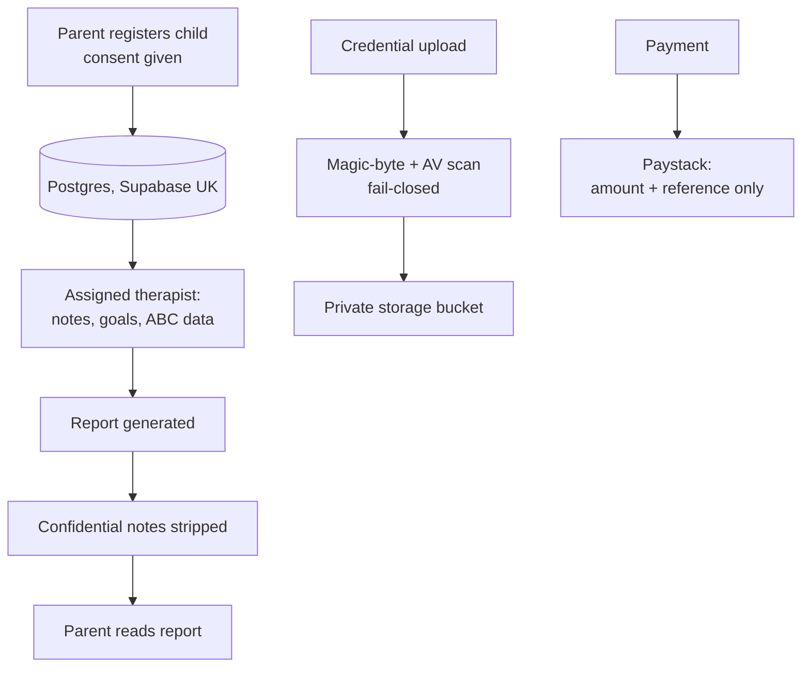
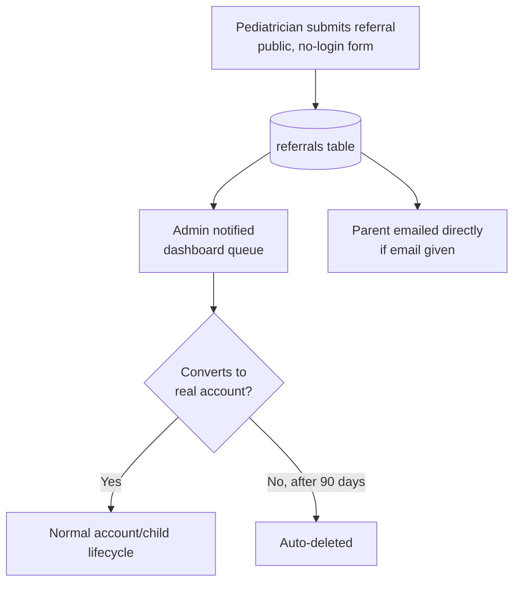

# Data Protection Impact Assessment — Hayven — DRAFT

> **This is a technically mature draft, not a completed DPIA.** It's written from direct
> knowledge of the actual system (built and security-audited over this project's
> history), so the factual/technical sections are accurate as of the dates below. But a
> DPIA under the NDPA/GAID framework is a governance and legal instrument, not only an
> engineering one — the lawful-basis analysis (§3), the children's-data safeguarding
> posture (§4), the international-transfer register (§6), the risk ratings (§11), and
> the sign-off (§14) all need the now-named DPO's formal review, completed NDPC/GAID
> DPO verification, and Nigerian legal counsel before this is a real, adopted
> assessment rather than a strong starting point. Use this as the structure and
> factual base, not as evidence of compliance on its own.

**Date of original draft:** 2026-09-19
**Updated 2026-09-23 (I):** added the referral data flow and the second security audit's
closures — see the prior revision history preserved in version control.
**Updated 2026-09-23 (II):** restructured following an external legal-context review —
added a lawful-basis matrix (§3), a dedicated children's/vulnerable-persons section
(§4), an expanded international-transfer register (§6), a risk-scoring methodology
(§10), a breach-response section (§13), and reordered every open item into launch-
blocking (P0) / pre-scale (P1) / ongoing (P2) tiers. The regulatory citations added in
this revision (GAID 2025, the 200-data-subjects/6-month major-importance threshold, the
72-hour breach notification window, the DPO verification/CPD framework) were checked
against public NDPC and law-firm sources on 2026-09-23 (see citations inline) — they are
not fabricated, but a compliance document of this kind should still have its regulatory
citations confirmed by Nigerian counsel before anyone relies on them, since secondary
sources can lag or misstate a regulator's own text.
**Updated 2026-09-23 (III):** Ademola Yusuf (Founder) named as Hayven's initial Data
Protection Officer — an informal, founder-wearing-the-hat appointment, not yet
NDPC-verified under GAID Schedule 3. Closes the "nobody named" half of risk #7 and
§12 P0-2; does not close the "GAID-verified" half. Sign-off (§14), §7's consultation
checklist, and §15's open items updated to match; nothing else in this revision.
**Updated 2026-09-23 (IV):** Ademola Yusuf (Founder) also named as Hayven's Designated
Safeguarding Lead (`docs/safeguarding-procedure.md` §2). Closes the "nobody named" half
of risk #6; explicitly does not close the "fully operative" half — the procedure still
has open `[FILL IN]` items pending safeguarding-adviser/legal review.
**Updated 2026-09-23 (V):** Yusuf Omotoyosi named as Deputy DSL
(`docs/safeguarding-procedure.md` §2), closing the single-point-of-failure gap flagged
in (IV) — the DSL is no longer the only person who can act on a concern. Still open:
briefing the deputy on §3–§6 of the procedure, and the same `[FILL IN]` items as (IV).
**Updated 2026-09-23 (VI):** drafted a first breach-response runbook
(`docs/breach-response-runbook.md`), closing the "nothing written" half of risk #13
and §12 P0-9. Grounded in the actual system (the AUTH-01 suspension fix, `audit_log`,
Sentry, Cloudmersive's fail-closed scanning) rather than generic advice, and reuses
the DPIA's own §10 risk-scoring scale instead of inventing a parallel one. Does not
close the "tested" half — still needs a tabletop run-through and counsel's
confirmation of the actual NDPC filing mechanics.
**Updated 2026-09-23 (VII):** minimised the public referral form's free-text field
(`src/components/marketing/pediatrician-referral-form.tsx`) — reframed from open
"anything else worth knowing" to logistics-only, with explicit copy telling the
referrer clinical detail isn't needed there. Closes §12 P1-14. A copy-level change,
not a removal: nothing about what's stored, purged, or sent to the parent changed,
and the underlying lawful-basis question for referral data (risk #14, Part A of
`docs/counsel-briefing-legal-review.md`) is unaffected by this and still open.
**Updated 2026-09-23 (VIII):** the audit log (§9.5) now records admin sign-ins and
two-factor changes, closing a gap cross-role QA found: admins' own security-relevant
actions were absent from the trail that exists to show who did what. Covered by a
new integration test against a real database.
**Updated 2026-10-09 (IX): two-factor authentication removed.** At the owner's
decision, the authenticator-app second factor was removed from the platform for
every role, including admins (no account had one set up at the time). Sign-in is
now email + password, or Google for parents. This raises the residual rating of
risk #1 (§11) and reverses the step-up safeguard in §9.1; counsel and the DPO
should weigh whether that's acceptable for accounts that can read children's
clinical data and the safeguarding log.
**System assessed:** Hayven (paediatric-therapy marketplace web application and PWA)
**Data controller:** Hayven Health Limited (RC 9879135), registered at No. 17, Aganga
Williams, Ogba, Ikeja, Lagos State, Nigeria — incorporated 2026-09-22; added once
incorporation completed and verified against the CAC certificate/status report, not
present in the original 2026-09-19 draft.
**Author of this draft:** Written by Claude (Anthropic), from direct knowledge of the
codebase, its security audit history, and its data model — not a substitute for DPO or
legal review.

---

## 1. Why this assessment exists

Hayven processes children's health and developmental data, and therapists' professional
credential data, at meaningful scale for a Nigerian platform. Nigeria's data protection
framework changed materially in the period this document has existed: the NDPC's
**General Application and Implementation Directive (GAID) 2025** took effect on
**19 September 2025**, six months after publication, and operationalises much of what
the Nigeria Data Protection Act 2023 (NDPA) left as high-level principle — including
naming specific circumstances in which a DPIA is *mandatory*, not merely advisable
([DLA Piper](https://privacymatters.dlapiper.com/2025/06/nigeria-ndpc-issues-gaid-key-compliance-insights/),
[Mondaq](https://www.mondaq.com/nigeria/privacy-protection/1618278/key-highlights-of-the-nigeria-data-protection-act-general-application-and-implementation-directive-2025)).
Those circumstances include processing sensitive/highly-personal data, processing data
of vulnerable data subjects, and healthcare-service processing — Hayven's core business
sits inside more than one of them simultaneously (children's data, health/developmental
information, vulnerable data subjects, healthcare/therapy services, cross-border
processing, and payment processing).

**This DPIA is therefore best framed as a mandatory compliance and risk-management
measure under the applicable NDPA/GAID framework, not only as a voluntary best-practice
exercise** — a stronger and more accurate framing than the original draft's softer "this
is probably high-risk" language. That reframing is itself an open item for counsel: this
document asserts *why* a DPIA is warranted from the public GAID text, but only counsel
can confirm which specific mandatory-DPIA circumstance(s) apply to Hayven and whether the
GAID's filing timelines (four months for sensitive-data processing deployed after GAID,
six months for pre-existing processing, per the sources above) already govern this
platform's own timeline.

This document is that assessment: what's processed, why, what could go wrong, what
already guards against it, and what's still open.

---

## 2. Description of the processing

### 2.1 Nature

Hayven is a two-sided marketplace: parents/caregivers book and pay for paediatric
therapy sessions with independent, Hayven-verified therapists; therapists record
session notes and publish progress reports back to parents. A supervisor role can
oversee a group of therapists' clinical work. Admins operate verification, disputes,
refunds, and payouts.

### 2.2 Scope — data processed, by category

| Category | Examples | Data subject | Special-category? |
|---|---|---|---|
| Account data | Full name, email, phone, hashed password, role | All users | No |
| Child profile | First name, date of birth, presenting concern, diagnoses | Children (entered by parent) | **Yes — health data, and data about a child** |
| Clinical/session data | Session notes, goals, target behaviours, ABC observations, published reports | Children | **Yes — health data** |
| Confidential clinical notes | A subset of session observations never shown to the parent, visible only to the assigned therapist(s)/supervisor | Children | **Yes — health data** |
| Therapist professional data | Bio, qualifications, licence/credential documents, years of practice | Therapists | Professional/sensitive by nature of the document type (may include identity documents) |
| Booking & payment | Session bookings, amounts, Paystack transaction references | Parents, therapists | No (financial, not special-category, but sensitive) |
| Messages | Parent–therapist messages tied to a booking | Parents, therapists | Possibly — messages could incidentally contain health information |
| Technical/security logs | Sign-in timestamps, IP-adjacent access logs kept by infrastructure providers | All users | No |
| Product analytics | Page views, coarse actions (e.g. "booking started"), role | All users | No — explicitly excludes child data, session notes, report content (enforced by an allowlist, see §9.3) |
| Referral data | Child's name and age, a category-level reason for referral, free-text clinical context, a parent/guardian contact detail, and the referring clinician's own name/facility/contact | Children and prospective parents (referred by a third party — a pediatrician or other clinician — not self-submitted) | **Yes — health-adjacent, and data about a child, collected from someone other than the child's parent** |

### 2.3 Context

- Children never hold their own accounts; a profile is created and controlled entirely
  by the registered parent.
- Access to a child's clinical data is scoped, at the database level (Postgres Row-Level
  Security), to: the child's own parent, the therapist(s) actively assigned to that
  child, that therapist's supervisor (where applicable), and admins (for safety/support).
  This is enforced by RLS policies and revoked-then-re-granted column ACLs, not only by
  what the application's UI happens to show.
- Confidential clinical notes are a distinct field, never included in the report a
  parent sees, and RLS-scoped separately from the parent-visible report. See §9.7 for
  the open questions this raises once a child has more than one discipline of
  therapist involved.
- **Referral data is the one category not initiated by the data subject's own family**:
  a pediatrician or other clinician submits it through a public, no-login form, before
  the parent has necessarily interacted with Hayven at all. This inverts the platform's
  normal data-provenance model (parent → Hayven → child becomes clinician → Hayven →
  child/parent) — see §4 and risk #14 in §11. The submitting clinician must explicitly
  confirm the parent/guardian is aware of and agrees to the referral before the form
  will submit (`src/lib/referrals/actions.ts`) — an attestation, not a verification. A
  referral that never converts to an active family is automatically deleted after 90
  days (`purgeStaleReferrals`, `src/lib/referrals/cron.ts`); one that converts is
  excluded from that purge and lives on under the normal account/child lifecycle.

### 2.4 Purposes

Account security and therapist verification; matching families with therapists and
managing bookings/scheduling/payments; enabling therapists to record sessions and
generate parent-facing reports; supervisor oversight of assigned therapists; safety
investigation and enforcement of platform terms; an audit trail of sensitive actions;
legal/tax/professional record-keeping.

---

## 3. Lawful basis for processing

The original draft explained *why* data is collected but did not systematically map
*what NDPA lawful basis each processing activity relies on* — the single biggest
substantive gap an external legal-context review identified in it. This section is that
map, in skeleton form; every "Needs legal review" cell is a real gap, not a formality.
A consolidated, counsel-ready version of this table lives in
`docs/counsel-briefing-legal-review.md` Part A, alongside the Therapist Agreement's
liability questions and the transfer register below — hand that single document to
whoever reviews this, rather than this full DPIA.

| Processing activity | Data involved | Purpose | Proposed lawful basis | Notes |
|---|---|---|---|---|
| Parent account creation | Identity/contact | Enable account use | Contract (necessary steps to enter a contract) | Relatively low-risk to confirm |
| Child profile creation | Health/developmental data | Enable therapy delivery | **Needs legal review** — likely a special condition for sensitive personal data, not contract alone | See below |
| Session notes, goals, reports | Health data | Care documentation and continuity | **Needs legal review** | Special-category processing |
| Confidential clinical notes | Health data | Clinical record-keeping distinct from the parent report | **Needs legal review** | Same special-category analysis as above, plus a minimisation argument (§8) |
| Therapist credential verification | Licence/credential documents | Professional verification | **Needs legal review** — legal obligation, legitimate purpose, or contract, depending on how NDPA characterises marketplace vetting | Counsel to determine |
| Booking and payment | Transaction data | Deliver and charge for the service | Contract; also likely a legal obligation basis for the underlying payment-processing/tax record | Paystack is the processor |
| Security/audit logs | Technical identifiers, actor/action metadata | Security, incident investigation, accountability | Legitimate interest, or legal obligation depending on the specific log | Time-bounded (§9.4) |
| Marketing communications | Contact data | Marketing (if/when Hayven sends any) | Consent | Kept separate from transactional/service email, which doesn't need marketing consent |
| Product analytics | Allowlisted usage events | Product improvement | **Needs legal review** — consent, legitimate interest, or another basis, depending on counsel's read of the NDPA on non-identifying analytics | Already minimised by allowlist (§9.3) regardless of the basis chosen |
| Referral intake | Child + clinical-adjacent context, collected from a third party | Facilitate the referral and first contact | **Critical legal review** — the referrer's attestation is not the parent's own consent; this may need a distinct basis (legitimate interest in facilitating a professional referral, time-limited) rather than being treated as parental consent by proxy | See §4 and risk #14 |

The document's own consent language up to this revision leaned on "the parent provides
consent" as a general answer across several of these rows. That's appropriate for some
of them and is already backed by a genuinely granular, revocable consent system (the
intake-form "Consent & sharing" section, §9.1) — but consent shouldn't become the
platform's universal answer, because it creates real downstream problems around
necessity, withdrawal, processing that needs to continue for clinical-continuity or
safeguarding reasons even if consent is nominally withdrawn, and retention after
withdrawal. What Hayven has today is a strong **consent history mechanism**; what it's
still missing is the **lawful-basis architecture around it** — a per-purpose mapping of
data → basis → special condition (where sensitive data is involved) → notice →
retention → the data subject's actual rights against that specific processing. This
table is the start of that mapping; the "Needs legal review" cells are where counsel's
work actually begins.

---

## 4. Children and vulnerable data subjects

Hayven processes personal and health-related information concerning children who may
have developmental, behavioural, psychological, neurological, or learning-related
needs. Children may have reduced ability to understand the consequences of data
processing about them, and in Hayven's case never directly control or even see that
processing — it is mediated entirely through a parent, or, in the referral flow (§2.3),
initially through neither the parent nor the child, but a third-party clinician.

**Safeguards already implemented:**

- Parent/guardian-controlled accounts; no child self-registration is possible.
- An explicit, separate guardian-status and processing-consent checkbox at the point a
  child is added (distinct from the blanket sign-up Terms acceptance).
- A granular, revocable, timestamped consent system once a child exists (the intake
  form's "Consent & sharing" section).
- Minimum-necessary data collection per the necessity analysis in §8.
- Database-level (RLS) access restrictions, not just application-layer checks.
- A separate confidential-clinical-notes field, scoped away from the parent-visible
  report.
- Restricted therapist assignment — access requires an active assignment, not just a
  platform-wide therapist role.
- Comprehensive audit logging of sensitive actions (§9.5).
- Defined, implemented retention and purge periods (§9.4).
- A referral auto-purge specifically bounding how long a third-party-submitted child
  record persists if it never converts to a real account (§2.3).
- Restrictions on what reaches analytics tooling (§9.3).
- Deletion/purge mechanisms for account, clinical, payment, and referral data.
- Human review of professional (therapist) verification, not an automated pass.

**Residual risks specific to children's vulnerability, not fully addressed by the above:**

- The referral flow's third-party-collection problem (§2.3, risk #14) — a parent's
  awareness of their child's data being processed is attested to by someone else, not
  confirmed by the parent themselves, until Hayven's own outreach happens.
- The safeguarding procedure has a named DSL and Deputy DSL as of 2026-09-23 but is
  still not fully operative (risk #6) — several procedural `[FILL IN]` items remain
  (escalation channel, external authority, record retention) — and this is arguably
  the single most consequential residual item in this entire document, because it
  concerns a child's immediate physical/psychological safety, not just their data.
- No dedicated clinical-information-governance policy yet answers who decides what
  belongs in a "confidential" note versus a shared one, or what happens to a child's
  data as their care team changes (§9.7).
- No age-appropriate, independent mechanism exists (nor is one proposed) for a child
  old enough to have a view on their own data to express one — likely out of scope
  for Hayven's actual population (paediatric, parent-mediated care) but worth counsel
  confirming that assumption rather than leaving it silently assumed.

---

## 5. Data flows

Booking/session/report events are written to `audit_log` (service-role only, no
user-facing grant). Coarse product events (role, action, timing — never PII/clinical
content) reach PostHog (EU) and GA4. See §6 for where each of these processors is
located and what governs the transfer.

---

## 6. International transfers and processor register

The question this section answers is not simply "where is the server" — it's what data
leaves Nigeria, who receives it, for what purpose, where it's actually processed, under
what contractual arrangement, and under what NDPA transfer mechanism. The register below
is the start of that answer; the "DPA" and "Transfer mechanism" columns are the two
columns counsel needs to close before this section is more than a location inventory.
See `docs/counsel-briefing-legal-review.md` Part C for the counsel-ready version of
this table with priority ranking and the specific per-vendor questions.

| Vendor | Data received | Purpose | Primary location | DPA executed? | Transfer mechanism | Status |
|---|---|---|---|---|---|---|
| Supabase | Clinical, account, full dataset | Database, auth, file storage | UK (eu-west-2, London) | Not confirmed | Needs counsel | 🟠 Open |
| Vercel | Application/request data | Hosting, serverless functions | UK (functions pinned to lhr1) | Not confirmed | Needs counsel | 🟠 Open |
| Paystack | Transaction references, amounts | Payment processing | Nigeria | Not confirmed | Domestic — likely lowest-risk of this table | 🟢 Lower priority |
| PostHog | Allowlisted coarse events only | Product analytics | EU Cloud | Not confirmed | Needs counsel | 🟢 Lower priority (minimised, EU) |
| Sentry | Error/stack-trace metadata; PII explicitly disabled | Error monitoring | Confirmed EU (Frankfurt, Germany) | Not confirmed | Needs counsel | 🟠 Open |
| Resend | Email content/metadata, recipient address | Transactional email | US by default (confirmed via vendor docs) | Not confirmed | Needs counsel | 🔴 Priority |
| Cloudmersive | The uploaded credential file itself (scanned, not stored, by this call) | Malware scanning | Likely US by default (global endpoint; EU regions exist only on paid tiers, not configured here) | Not confirmed | Needs counsel | 🔴 Priority |
| Google Analytics | Allowlisted coarse events, if configured | Site-traffic analytics | **Not confirmed** — the one processor whose region is still genuinely unknown | Not confirmed | Needs counsel, once location is known | 🔴 Priority |
| Google (sign-in, parents only, optional) | Parent's name and verified email, received from Google at sign-in; nothing about children or platform use is sent to Google | Optional "Continue with Google" authentication | Not confirmed (Google identity services; location and role as independent controller vs processor to be confirmed) | Not confirmed | Needs counsel | 🟠 Medium |

Most of the system's core data (the database itself, and the servers that query it) is
UK-based, which is the most consequential fact for a transfer assessment — the
remaining processors above handle either no personal data, or a narrow, defined slice
of it (payment references, coarse analytics events, error stack traces, email metadata,
a credential file's scan request). That narrows the practical exposure but doesn't
close the documentation gap: none of the "DPA executed?" cells above are confirmed yes,
and per §12 (P0 item 7), most of these vendors publish a standard clickthrough DPA —
confirming and executing each is real, usually fast, work, not just a documentation
update to this file.

---

## 7. Consultation

**Not yet done.** A real DPIA is a consultation exercise, not a solo document, and the
GAID framework's own DPIA requirements describe review by a verified DPO and inclusion
of the DPIA's outcome in compliance/audit reporting — not simply a document somebody
signs. Before this is adopted, the intended chain is:

**Founder/engineering assessment → DPO review → legal review → safeguarding review →
remediation → DPO approval → adoption → regulatory filing/record as applicable.**

This document is the first link in that chain. Specifically still needed:

- [ ] Ademola Yusuf (Founder), named DPO as of 2026-09-23, to formally review this
      document end-to-end and record the review here — naming the role is done;
      the review itself, and NDPC/GAID verification, are not.
- [ ] The Designated Safeguarding Lead's (Ademola Yusuf) and Deputy DSL's (Yusuf
      Omotoyosi) formal review of this document — both are named
      (`docs/safeguarding-procedure.md` §2), but the procedure itself has the same
      "not yet operative" status as this document, for the same reason — see §4
      and risk #6.
- [ ] Nigerian legal counsel, specifically on: the lawful-basis matrix (§3), the
      "major importance" determination (§12, P0 item 4), and the transfer register (§6).
- [ ] If Hayven works with a specific clinical/therapy advisory body, their review of
      the clinical-data-handling sections specifically (§9.7).

---

## 8. Necessity and proportionality

**Is each category of data actually necessary for the stated purpose?**

- Child profile and clinical data: necessary — the entire service is delivering and
  documenting paediatric therapy; there's no way to provide or evidence care without it.
- Confidential clinical notes, separate from the parent report: this is a *minimisation*
  measure, not an expansion — it exists specifically so sensitive clinical
  observations aren't over-shared with a parent by default, while still being
  recorded for continuity of care between therapists/supervisors.
- Therapist credential documents: necessary for the verification promise the platform
  makes to families; retained only as long as needed for that verification and any
  professional record-keeping obligation.
- Product analytics: deliberately minimised by an explicit allowlist (see §9.3) rather
  than free-form event capture — a specific design decision, not a default.
- Technical/security logs: necessary for account security and incident investigation;
  time-bounded (24 months, see §9.4).
- **Referral data:** the public referral form's reason-for-referral field was already
  categorical (predefined tags, e.g. "Speech / language", "Behavior"), but its
  free-text field was labelled "Additional information" with a placeholder inviting
  open narrative ("Anything else worth knowing") — collecting more than needed to
  *initiate contact*, before the family has any relationship with Hayven.
  **2026-09-23: narrowed.** The field is now framed as logistics only ("best time to
  reach the family, a language preference"), with explicit copy telling the referrer
  clinical detail isn't needed there (`src/components/marketing/pediatrician-referral-
  form.tsx`). This is a copy-level minimisation, not a removal — the field still
  exists for genuinely logistical notes, and nothing about what's stored, purged, or
  sent to the parent (still never restated in the parent email, §2.3) changed.

**Could the same purpose be achieved with less data, or less identifiable data?** Two
places this stays open: Google Analytics (§6) — coarse, non-identifying events already,
but processing location unconfirmed — and the referral form above.

---

## 9. Existing safeguards

A security audit was conducted (`docs/production-audit-2026-09-03.md`, commit `d4d01cd`)
identifying 1 high-severity, 5 medium, and 10 low-severity findings; all were
remediated, most verified by dedicated integration tests. A second, independent audit
followed (2026-09-23), closing 21 further findings across access control and
payment/booking integrity, each with its own regression test (92 integration tests
total, run against a real throwaway Supabase project under real Row-Level Security, not
mocked). What follows is what's actually implemented today, with evidence, not
aspirational language.

### 9.1 Access control

- Row-Level Security on every table holding personal or clinical data, scoping reads to
  the parent of a child, the therapist(s) assigned to that child, their supervisor, and
  admins — not just an application-layer check.
- Sensitive columns (`role`, `verification_status`, `confidential_note`,
  `reviewer_notes`, `debug_payload`) are column-ACL-revoked-and-regranted, not merely
  row-scoped.
- ~~MFA (TOTP) with step-up enforcement~~ — **removed 2026-10-09** (see update IX
  above). Every account now relies on its password (or Google, for parents), plus
  login rate-limiting and account suspension.
- Signup role is server-validated against an allowlist (parent/therapist only) — no
  self-service path to an admin or supervisor account.
- An explicit, separate checkbox at child-add time (migration `0081`,
  `children.guardian_consent_at`) confirms guardian status and consent to processing
  health/developmental information, distinct from the blanket sign-up Terms
  acceptance.
- Pre-existing: the intake form's "Consent & sharing" section (migration `0077`, table
  `intake_consents`) asks for granular, per-purpose, revocable consent — therapist
  access (required), sharing with named others, photos/video, and de-identified
  product-improvement use (all optional) — each timestamped and kept as history when
  changed, not overwritten.
- **Second audit closures (2026-09-23), each with a dedicated regression test:**
  suspension now actually revokes an existing session's database access, not just UI
  access (AUTH-01) — this directly reduces the residual likelihood on risk #1 in §11; a
  supervisor could read more of a supervised therapist's own account row than intended
  (RLS-01); the report supervisor-approval gate depended on an unrelated RLS grant to
  work correctly (RLS-02/04); a therapist could edit or delete another clinician's
  diagnosis entry on a shared case (RLS-03); `availability_slots` was publicly
  queryable for a therapist who shouldn't be publicly bookable (RLS-05); a parent could
  directly set `intake_forms.therapist_notified_at`, bypassing the real notification
  flow (RLS-06); a parent could directly delete their own child's row, bypassing the
  retention/purge lifecycle in §9.4 (RLS-07); a referral-status lookup could be
  brute-forced against a specific targeted email (F1). Eight further findings from the
  same pass concerned payment/booking integrity rather than access control directly
  (see §9.6).

### 9.2 Data minimisation and integrity in transit/storage

Credential document uploads are magic-byte sniffed, scanned by Cloudmersive with
fail-closed behaviour, stored under generated paths in a private bucket with per-user
folder RLS. The `avatars` bucket (the one public-by-design bucket) is restricted to
image MIME types and a size cap. Passwords are hashed by the authentication provider.
Paystack webhook payloads are verified with an HMAC-SHA512 timing-safe signature check
before any write.

### 9.3 Analytics minimisation

Product analytics (PostHog) and site analytics (GA4) both go through a single
allowlist function (`sanitizeProps`) rather than passing through arbitrary event
properties — role, step, count, amount, and enum-typed fields only. No child name, date
of birth, presenting concern, session note, or report content ever reaches either
analytics tool. Autocapture is off; the current page URL's query string is stripped
before send.

### 9.4 Retention

| Category | Period | Basis for the period |
|---|---|---|
| Personal account data | 30 days after a verified deletion request | **Needs a documented rationale** — currently an operational decision, not tied to a specific legal minimum |
| Clinical records (incl. a child's core identifying details) | 6 years past a child's last session | **Needs a documented rationale** — likely professional record-keeping/limitation-period reasoning, but counsel should confirm and state which |
| Payment records | 6 years from the transaction date | **Needs a documented rationale** — likely a tax/financial record-keeping requirement; counsel to confirm the specific Nigerian rule relied on |
| Security/audit logs | 24 months | Operational decision |
| Referral data (unconverted) | 90 days from submission | Operational judgment call, explicitly not a legal minimum (§2.3) |

All five categories are implemented and scheduled via automated purge jobs (personal
account: `src/lib/account/purge.ts`; audit log: `src/lib/audit/cron.ts`; clinical:
`src/lib/clinical/purge.ts`; payment: `src/lib/payments/retention.ts`; referral:
`src/lib/referrals/cron.ts`), and a parent can no longer bypass the clinical purge
lifecycle by directly deleting their child's row (§9.1, RLS-07). What's missing is not
the mechanism — it's a documented *reason* for each period, so that when someone
eventually asks "why six years," the answer is on record rather than reverse-engineered
after the fact.

### 9.5 Accountability

An `audit_log` table (service-role-only, no user-facing grant) records sensitive
administrative actions — verification decisions, clinical record access patterns,
payout runs, refund decisions — with actor, action, and metadata. Since
2026-09-23 it also records privileged-access events, which cross-role QA found
were missing: every admin sign-in (and, until two-factor was removed on
2026-10-09, any account turning it on or off). Ordinary
parent and therapist sign-ins are deliberately not logged, to keep the log
meaningful rather than noisy.

Since 2026-09-24 it also records every report download (`report.download`, with
actor, role, report, child and which version). Reports can be downloaded as PDFs:
the clinical version by the therapist who wrote it and by a supervisor with an
active assignment to that therapist (logged with `as: supervisor`), and the parent
version by that therapist or by the child's parent once it is published. Access is checked in
the download route itself (not only in the UI), downloads are rate-limited, the
response is not cacheable, and each file carries a confidentiality footer naming the
person who downloaded it. What the platform cannot control is what happens to the
file afterwards (risk #16).

### 9.6 Money-flow correctness (indirect safeguard)

Not a privacy control on its face, but relevant to data integrity: a concurrency bug
that could have double-paid a therapist (found and fixed, then proven fixed by a real
integration test firing simultaneous requests against a live database) is the kind of
defect that, left open, would have produced an inaccurate financial and audit record —
a DPIA-relevant integrity concern, not just a money one. The second audit's remaining
eight payment/booking findings (duplicate-charge handling, refund double-processing, a
webhook-retry deadlock, a reconciliation sweep that silently stopped on the first bad
record) are the same category of concern, all closed with regression tests.

### 9.7 Clinical information governance

This is a genuine open question, not yet answered by policy: the platform enforces a
*privacy* restriction (who can see a confidential note) but has no written policy on
the *clinical-appropriateness* judgment behind it. Specifically unanswered:

- Who decides what belongs in a confidential note versus the shared parent-facing
  report?
- If a confidential note contains information genuinely necessary for another
  treating professional's care of the same child (e.g. a speech therapist's
  observation relevant to an occupational therapist also assigned), can they see it,
  and should they?
- Can a supervisor see everything on a case they oversee, including confidential
  notes, by default?
- What happens to a therapist's authored notes/access after they're suspended, or
  after they leave the platform (offboarding already ends assignments and cancels
  future bookings — §9.1 — but doesn't itself answer the clinical-governance
  question)?
- What happens to continuity of clinical information as a child's care team changes
  membership over time?

None of this is a code defect — the access-control mechanics (§9.1) are sound. It's a
missing policy layer on top of sound mechanics, and it matters more as Hayven supports
more than one discipline of therapist per child.

### 9.8 Known, deliberately accepted residual items

- `script-src 'unsafe-inline'` in the Content Security Policy is a documented,
  bounded trade-off of the React Server Components rendering model, not an oversight.
- A vendor-agnostic meeting-link field (for virtual sessions) accepts any `https:` URL
  rather than an allowlist of known video providers — accepted given therapists are
  individually vetted before they can practise on the platform.

---

## 10. Risk-scoring methodology

The original draft rated risks qualitatively (Low/Medium/High) with an explicit
disclaimer that these were a builder's first estimate. That honesty is preserved, but a
DPIA that will actually be reviewed by a DPO and counsel benefits from a reproducible
scale rather than adjective judgment calls alone:

**Likelihood:** 1 Rare · 2 Unlikely · 3 Possible · 4 Likely · 5 Almost certain
**Impact:** 1 Negligible · 2 Minor · 3 Moderate · 4 Major · 5 Severe

**Inherent risk = likelihood × impact** (before any mitigation). **Residual risk =
likelihood × impact after the mitigations in §9.** The qualitative Low/Medium/High
labels in §11's table map approximately to Low = 1–6, Medium = 7–14, High = 15–25 on
this 5×5 scale — a simple matrix is enough here; this isn't a request for a heavier
enterprise framework than a platform this size needs. Whoever formally adopts this
document should re-score every row on this scale explicitly, rather than trusting the
qualitative labels alone.

---

## 11. Risk identification and assessment

For each risk: what could happen, to whom, likelihood and severity **before**
mitigation, and the residual risk **after** the safeguards in §9. Ratings are a starting
estimate from the system's builder — recalibrate on the §10 scale with whoever formally
owns this document.

| # | Risk | Data subject | Likelihood | Severity | Mitigation | Residual risk |
|---|---|---|---|---|---|---|
| 1 | Account compromised (credential stuffing, phishing), exposing a child's clinical record | Child | Medium | High | Rate-limited login; suspension now revokes an existing session's RLS access (§9.1, AUTH-01). Two-factor removed 2026-10-09. | **Medium** — password-only for every role, including admins |
| 2 | A therapist queries or is granted access to a child not assigned to them | Child | Low | High | RLS row-scoping, hardened further by 5 findings in the second audit (§9.1) | Low — DB-enforced, 92 regression tests |
| 3 | A credential upload contains malware, or a spoofed file type | Therapist, platform | Low | Medium | Magic-byte + fail-closed AV scan (§9.2) | Low |
| 4 | Analytics tooling captures identifying or clinical data by accident | Child, parent | Low — structurally prevented, not just policy | High if it occurred | Allowlist-based `sanitizeProps` (§9.3) | Low |
| 5 | A therapist's payout is paid twice due to a concurrency bug | Therapist, platform | Was Medium; now fixed and integration-tested | Medium | Atomic claim + real concurrent-request test (§9.6) | Low |
| 6 | A safeguarding concern about a child is raised but has no defined, working path to a responsible person | Child | Low-Medium — DSL and Deputy DSL both now named (2026-09-23) | **High** | Draft procedure exists, DSL + Deputy DSL named; procedure still has `[FILL IN]` markers pending review | **Medium — naming both roles closes the "nobody to reach, no cover" gap; residual is now the procedure's remaining open items (escalation channel, external authority, record retention) rather than an unstaffed role; see §12 P0-1** |
| 7 | A data subject rights request has nowhere specific to go, or no defined SLA is met | Parent, therapist | Medium | Medium | A contact email exists; NDPA-timeframe commitment stated in the Privacy Policy; **(2026-09-23) an initial DPO has been named** (founder appointment — Ademola Yusuf) | Medium-Low — a named owner now exists for a rights request to reach, but NDPC DPO verification (GAID Schedule 3) hasn't been completed; see §12 P0-2 |
| 8 | Cross-border transfers have no documented NDPA transfer mechanism (§6) | All users (Resend); therapists (Cloudmersive) | Medium — a process gap, not a technical one | Medium | Most core data stays UK-based; the transfer register (§6) now documents locations, not yet mechanisms | Medium — open |
| 9 | Professional/clinical responsibility for a therapy outcome isn't clearly allocated between the therapist and the platform | Child, therapist | Medium | High | Terms of Service frames therapists as independent contractors | Medium — needs a standalone Therapist Agreement; a first draft exists (`docs/therapist-agreement.md`) |
| 10 | Platform responsibility — what Hayven actually provides versus warrants — isn't precisely scoped alongside risk #9 | Platform, therapist | Medium | Medium | Terms of Service disclaims clinical-outcome liability | Medium — same Therapist Agreement closes this |
| 11 | Data-controller/processor responsibility isn't contractually mapped between Hayven, therapists, and any clinics they're affiliated with | Child, therapist, platform | Not assessed | Medium-High | Not mitigated | Medium-High — a marketplace doesn't automatically make every participant the same type of data-protection actor; needs counsel |
| 12 | No verified backup/restore process exists, and a data-loss incident has no tested recovery path | All users | **Confirmed: Point-in-Time Recovery is disabled** (`pitr_enabled: false`, re-checked live via the Supabase CLI on 2026-09-23) | High if it occurred | None confirmed beyond whatever Supabase's plan tier includes by default | **High — launch-blocking; see §12 P0-8** |
| 13 | No fully tested personal-data breach response process exists | All users, regulator relationship | Low-Medium — a first-draft runbook now exists (`docs/breach-response-runbook.md`) | High | Runbook covers roles, detection, the 72-hour NDPC clock, and scenario playbooks; not yet tabletop-tested | Medium — written, not yet exercised; see §13 |
| 14 | Referral data (a child's name, contact details) is collected from a third party before the family's direct consent | Child, prospective parent | Low-Medium — referrer must attest parent awareness | Medium | Referrer attestation, 90-day auto-purge, prompt parent email (§2.3), minimised-form copy (§8, done 2026-09-23) | Low-Medium — attestation isn't verification, which the form redesign doesn't change; residual is now about the legal basis (Part A of `docs/counsel-briefing-legal-review.md`), not the volume of data collected |
| 15 | Hayven hasn't determined "data controller/processor of major importance" status or registered with the NDPC | Regulator relationship, all users indirectly | Not assessed | Medium-High | Not mitigated | **Medium-High — likely launch-blocking; see §12 P0-4.** The NDPC's published threshold is processing 200+ data subjects within a rolling 6-month window, and health-sector organisations are explicitly named among the sectors the "major importance" designation targets ([Michalsons](https://www.michalsons.com/blog/nigeria-data-protection-act-ndpa-controller-and-processor-registration/77465), [KPMG](https://kpmg.com/ng/en/home/insights/2024/03/nigeria-data-protection-commissions-guidance-notice-on-registration-of-data-processors-controllers-of-major-importance.html)) — counsel should treat this as a concrete determination to make, not an abstract question |
| 16 | A downloaded PDF report (clinical version or parent version) leaves the platform's technical controls: lost or shared device, forwarding, storage on a personal drive | Child, parent | Medium | Medium-High for the clinical version, Medium for the parent version | Clinical version limited to the owning therapist, parent version to that therapist and the child's parent once published; access enforced in the route, not just the UI; every download audit-logged; not cacheable; rate-limited; confidentiality footer naming the downloader; privacy policy §8 tells users the file is outside Hayven's controls | Medium — inherent once a file exists; the remaining lever is contractual and behavioural (see §12 P1 item 16a) |

---

## 12. Measures to address the remaining risk

Reordered this revision into launch-blocking (P0), pre-scale (P1), and ongoing (P2)
tiers, rather than one flat priority list — better matches how these items actually
gate a decision to process real children's clinical data at volume.

### 🔴 P0 — before production processing of real children's clinical data at any scale

1. **Make the safeguarding procedure fully operative** (risk #6) — the single
   highest-severity item in this document; it's about a child in active danger
   having no defined person to reach. **2026-09-23: Ademola Yusuf (founder) named
   as DSL, Yusuf Omotoyosi named as Deputy DSL** (`docs/safeguarding-procedure.md`
   §2), closing both the "nobody named" gap and the single-point-of-failure gap a
   solo founder holding DPO and DSL simultaneously would have left. Still open:
   briefing the deputy on §3–§6, and the procedure's remaining `[FILL IN]` markers
   pending safeguarding-adviser/legal review.
2. **Complete NDPC DPO verification for the now-named privacy owner** (risk #7) —
   **2026-09-23: Ademola Yusuf (founder) has been named as Hayven's initial DPO**, the
   informal-appointment step the original draft anticipated. This is not yet the full
   GAID picture: the GAID's DPO verification/continuous-professional-development
   framework (Schedule 3) ties formal DPO status to an NDPC verification and
   CPD-points mechanism, not a unilateral internal appointment
   ([Aluko & Oyebode](https://www.aluko-oyebode.com/insights/ndpc-issues-guidance-on-cpd-for-dpos/)).
   The remaining action is enrolling in and completing that verification, not naming
   someone — that part is done.
3. **Legal review of the lawful-basis matrix and sensitive-data processing** (§3) —
   every "Needs legal review" cell in that table.
4. **Determine "data controller/processor of major importance" status and register
   with the NDPC if required** (risk #15) — elevated this revision from a low-priority
   administrative question to a concrete legal determination, given the health-sector
   inclusion and the 200-data-subjects/6-month threshold now documented in §11.
5. **DPO review and approval of this DPIA itself** (§7) — not simply a signature; the
   GAID framework describes DPIA review as part of a verified DPO's actual function.
6. **International-transfer and vendor review** (§6) — close the "DPA executed?" and
   "Transfer mechanism" columns for every processor in that table.
7. **Execute Data Processing Agreements with each non-Nigeria processor** — most
   publish a standard clickthrough DPA; confirming and executing each is real, usually
   fast, work.
8. **Enable Point-in-Time Recovery and run a real restore drill** (risk #12) —
   confirmed disabled, re-confirmed live as of this revision. The drill should verify
   accounts, child records, clinical records, consent history, audit logs, and payment
   records all restore correctly into an isolated environment, and the result should be
   recorded back into this document. A step-by-step checklist now exists
   (`docs/backup-restore-drill.md`, 2026-09-24). It also flags a gap the database
   backup does not cover: files in Supabase Storage (credential documents, photos).
9. **Tabletop-test the breach-response runbook** (risk #13, §13) — the runbook
   itself is drafted (`docs/breach-response-runbook.md`); what remains is walking
   through it with the DPO and Deputy Safeguarding Lead and getting counsel's
   confirmation of the actual NDPC filing mechanics.
10. **Draft and execute a standalone Therapist Agreement** (risks #9, #10, #11) —
    covering professional/clinical responsibility, platform responsibility, and the
    data-controller/processor relationship between Hayven and its therapists. A first
    draft exists (`docs/therapist-agreement.md`), itself not ready to use.

### 🟠 P1 — before meaningful scale

11. **Reconsider the 2026-10-09 removal of two-factor authentication** for accounts
    with access to clinical data, admins first (risk #1).
12. **Resolve the Google Analytics processing-location question** (§6, risk #8), then
    feed the answer into the Privacy Policy's international-transfers section.
13. **Adopt a clinical-information-governance policy** (§9.7) answering who decides
    what belongs in a confidential note, cross-discipline visibility, and what happens
    to clinical access as a care team changes.
14. ~~Redesign the public referral form toward minimum-necessary collection~~ —
    **done, 2026-09-23** (§8). The reason field was already categorical; the
    free-text field is now framed as logistics-only, with explicit copy steering
    away from clinical narrative.
15. **Document a retention rationale for each period in §9.4** — not just the period
    itself, but the legal/professional/organisational reasoning behind each number.
16. **Set a recurring DPIA review cadence** (annually, and after any material change to
    what data is collected or how it's processed).

16a. **Add a downloaded-report handling clause to the Therapist Agreement** (risk
    #16): store clinical PDFs only on devices the therapist controls, keep them
    within the care team, do not forward outside the platform, delete them when no
    longer needed. Counsel and the DPO to confirm the wording and whether a
    retention period applies to downloaded copies.

### 🟢 P2 — ongoing

17. Annual (or trigger-based) DPIA review.
18. Periodic vendor/processor reassessment.
19. Periodic access review (who actually has clinical-data access, versus who should).
20. Safeguarding training once the procedure (P0-1) is operative.
21. Regular DPO reporting into whatever governance forum Hayven establishes.
22. Periodic penetration/security testing beyond the two audits already completed.

---

## 13. Breach response

**A first-draft runbook now exists** (`docs/breach-response-runbook.md`, drafted
2026-09-23), covering roles, detection sources, the 72-hour NDPC notification
clock, data-subject notification criteria, vendor-breach handling, and
scenario-specific playbooks for the cases listed below. It closes the "nothing
written" half of this gap, not the "tested and reliable" half — per its own open
items, it still needs a tabletop exercise with the DPO and Deputy Safeguarding
Lead, legal counsel's confirmation of the actual NDPC filing mechanics, and a
decision on where breach records live. The technical controls in §9 reduce the
likelihood of a breach but were never a response plan on their own — that
distinction is exactly why this document exists separately.

Under the NDPA, a data controller must notify the NDPC within 72 hours of becoming
aware of a breach, and must also notify affected data subjects without undue delay
where the breach is likely to result in a high risk to their rights and freedoms
([PrivacyNeedle](https://privacyneedle.com/compliance/legislation/the-72-hour-rule-what-ndpa-and-gdpr-say-about-data-breaches/)).
Scenarios the runbook covers: a therapist's account compromised; the database
itself compromised; a malicious credential document that evades scanning; a
clinical report sent to the wrong parent; a therapist accessing information they
shouldn't; referral data exposed; a vendor (Supabase, Vercel, Resend, Cloudmersive,
PostHog, Sentry, Paystack) suffering its own breach that implicates Hayven's data.
See risk #13 in §11 and P0 item 9 in §12.

---

## 14. Sign-off

| Role | Name | Date | Outcome |
|---|---|---|---|
| Author (this draft) | Claude (Anthropic) | 2026-09-19, restructured 2026-09-23 | Draft complete, not adopted |
| Data Protection Officer / privacy owner | Ademola Yusuf (Founder) | 2026-09-23 | **Named, initial appointment — NDPC/GAID verification not yet completed (§12 P0-2)** |
| Legal counsel | [FILL IN] | | |
| Designated Safeguarding Lead | Ademola Yusuf (Founder) | 2026-09-23 | **Named, with a Deputy DSL (Yusuf Omotoyosi); procedure not yet fully operative (see `docs/safeguarding-procedure.md` §2, §9)** |

**This DPIA is not fully in effect until the DPO row's NDPC verification is complete
and legal counsel has reviewed it, following the chain in §7** (founder/engineering
assessment → DPO review → legal review → safeguarding review → remediation → DPO
approval → adoption → regulatory filing/record as applicable). Naming a DPO closes
the "nobody owns this" gap the original draft flagged; it doesn't by itself satisfy
GAID's formal DPO-verification requirement, and this document should keep saying so
until that's actually done.

---

## 15. Open items before this is a real, adopted DPIA

Reorganised this revision to match §12's P0/P1/P2 structure, so this list and the
measures section stay in sync rather than duplicating slightly different orderings.

### P0 (launch-blocking)

- [x] Name a DPO/privacy owner — **Ademola Yusuf (Founder), named 2026-09-23** as an
      initial appointment. Still open: complete NDPC DPO verification/CPD enrollment
      (GAID Schedule 3) — naming someone isn't the same as GAID-verified status.
- [x] Name a Designated Safeguarding Lead and a Deputy DSL — **Ademola Yusuf
      (Founder) as DSL, Yusuf Omotoyosi as Deputy DSL, both named 2026-09-23**.
      Still open: briefing the deputy on §3–§6, and the safeguarding procedure's
      own remaining `[FILL IN]` items (escalation channel, external authority,
      record retention).
- [ ] Legal review of the lawful-basis matrix (§3) and the sensitive-data processing
      it covers.
- [ ] Determine "data controller/processor of major importance" status and register
      with the NDPC if required (§11, risk #15; §12, P0-4).
- [ ] DPO review and formal approval of this DPIA.
- [ ] Close the transfer-register gaps in §6 (DPA execution, transfer mechanism) for
      every non-Nigeria processor.
- [ ] Enable Point-in-Time Recovery on production, then run and record a real restore
      drill (§11, risk #12; confirmed disabled, re-confirmed live 2026-09-23).
- [x] Draft a breach-response runbook — **`docs/breach-response-runbook.md`,
      2026-09-23**. Still open: tabletop-test it, and counsel's confirmation of
      the actual NDPC filing mechanics (§13).
- [ ] Draft and execute the standalone Therapist Agreement (§11, risks #9–11).

### P1 (before meaningful scale)

- [x] Decide on MFA for therapist/supervisor/admin roles — **decided 2026-10-09:
      removed for all roles** (owner's decision). Residual risk #1 raised to Medium.
- [ ] Confirm Google Analytics' processing location and its NDPA transfer mechanism.
- [ ] Adopt a clinical-information-governance policy (§9.7).
- [x] Minimise the public referral form's free-text field — **done, 2026-09-23**
      (§8). The reason field was already categorical.
- [ ] Document a retention rationale per category, not just the period (§9.4).
- [x] ~~Explicit, separate consent for a child's sensitive data at the point it's first
      collected, and guardian-status confirmation~~ — addressed for the "Add a child"
      form; the intake-form consent system already covers the fuller, granular version.
      Still needs counsel's sign-off that the checkbox copy itself satisfies NDPA
      s.30/s.31.
- [ ] Get counsel's view on whether the referrer's attestation (risk #14) is a
      sufficient basis for processing a child's data collected from a third party, or
      whether something closer to verification is expected.

### P2 (ongoing)

- [ ] Recalibrate every risk in §11 on the §10 scale with whoever formally owns this
      document.
- [ ] Set and follow a recurring DPIA review cadence.
- [ ] Periodic vendor/processor reassessment, access review, and security testing
      (§12, P2).
